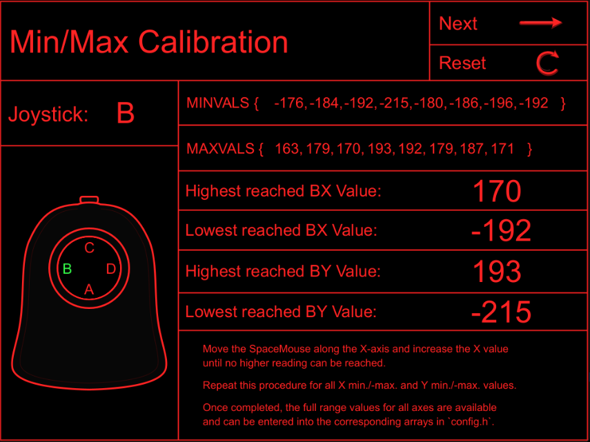
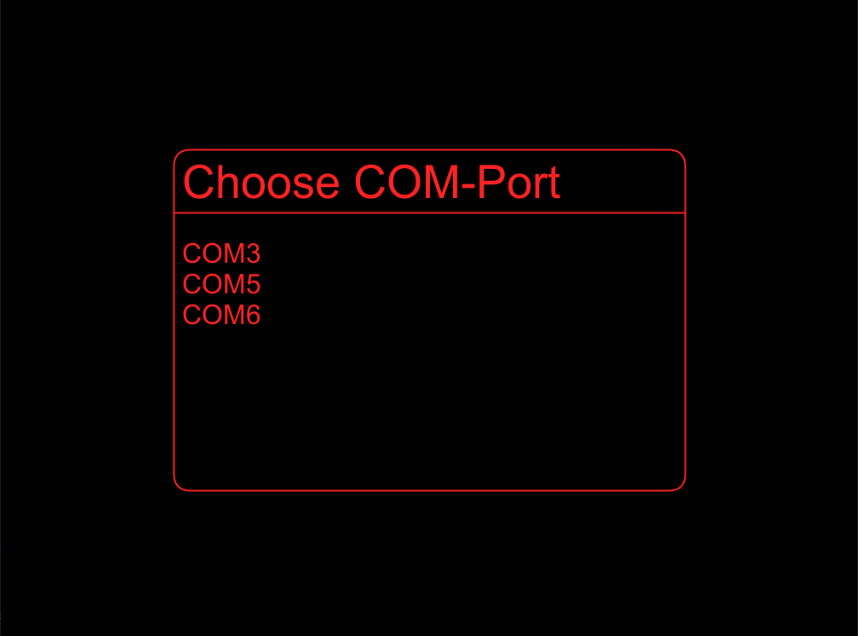
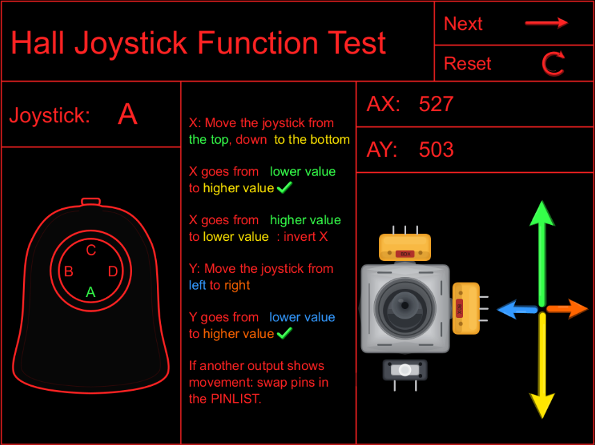
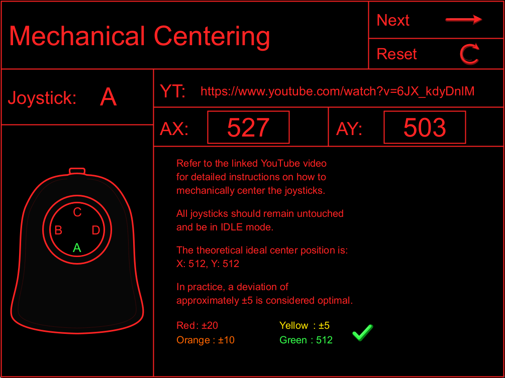

# SpaceMouse-Calibration-Utility
A graphical calibration and diagnostics utility for the AndunHH SpaceMouse firmware, built with Java and Processing.

## Project Overview

The SpaceMouse Calibration & Diagnostics Utility is a graphical desktop application developed in Java using the Processing framework. It provides a more intuitive way to monitor, diagnose, and calibrate joystick sensor values from the open-source AndunHH SpaceMouse firmware.
The application communicates directly with the microcontroller through the firmware's existing serial debugging interface.
**No modifications to the original firmware are required**.

The utility provides four interactive screens:

COM Port Selection:
* Select the serial port connected to the SpaceMouse.

Function Check:
* Monitor raw joystick sensor values in real time.
  
Hall-Effect Joystick Centering:
* Mechanically adjust the joystick center positions using color-coded visual feedback.
  
Min/Max Calibration:
* Continuously record the minimum and maximum joystick values and generate configuration arrays for config.h.

The main goal is to simplify the calibration process by replacing continuously scrolling serial monitor output with a structured and easy-to-read graphical interface.
This project is an independent companion utility and does not replace the original SpaceMouse firmware.

## Motivation – Why I Created This Utility

The original AndunHH SpaceMouse firmware already provides several debugging and calibration functions through the serial monitor. While these functions work well, continuously updating sensor values can become difficult to follow, especially when monitoring multiple joystick axes simultaneously.

I wanted to make this process more intuitive by developing a graphical interface that displays the sensor values in fixed positions instead of continuously scrolling through the serial monitor.

Another important goal was to simplify the mechanical centering of Hall-effect joysticks through color-coded visual feedback.

For the Min/Max calibration, I wanted to combine automatic value tracking with the flexibility of the manual calibration method. Unlike the firmware's time-limited semi-automatic calibration, my utility continuously records and displays the measured minimum and maximum values, allowing users to move each joystick for as long as needed and verify the results in real time.

**The goal was not to replace the existing firmware or its calibration functions, but to make the entire calibration process more transparent, accessible, and user-friendly.**

## Features & Screenshots

The utility provides four screens that guide the user through the connection, diagnostics, and calibration process.

### 1. COM Port Selection

Displays the available serial ports and allows the user to select the port connected to the SpaceMouse controller.

Once connected, the application communicates with the original AndunHH firmware through its serial debugging interface.

### 2. Function Check

Displays the raw 10-bit ADC readings (0–1023) of the selected joystick in real time using Debug Mode 1.

This screen helps verify the electrical connections, identify incorrect axis assignments, and determine whether an axis needs to be inverted in the firmware configuration.

### 3. Hall-Effect Joystick Centering

Provides visual assistance for mechanically centering Hall-effect joysticks.

The raw X/Y readings are evaluated against a theoretical center value of 512. Color-coded indicators show the deviation from the ideal center position, making mechanical adjustments easier to perform.

The displayed tolerances are intended as practical alignment guidelines rather than mandatory sensor specifications.

### 4. Min/Max Calibration

Continuously monitors the centered joystick values using Debug Mode 2 and records the minimum and maximum readings reached on all eight axes.

Unlike the firmware's time-limited calibration mode, the measurement remains active without a fixed time limit, allowing users to verify the full movement range of each joystick.

The recorded values are automatically formatted into `MINVALS` and `MAXVALS` arrays, ready to be copied into the firmware's `config.h` file.

## How It Works

The utility operates as a standalone Processing application and communicates with the original AndunHH SpaceMouse firmware through a USB serial connection at 115200 baud.

It uses the firmware's existing debugging interface to request and receive sensor measurements. No firmware modifications or additional microcontroller libraries are required.

### Serial Communication

After selecting the appropriate COM port, the application establishes a serial connection and automatically activates the required debugging mode.

Two debugging modes are used:

| Debug Mode | Purpose | Used In |
|---|---|---|
| **1** | Raw 10-bit ADC sensor readings (0–1023) | Function Check & Joystick Centering |
| **2** | Centered joystick sensor readings | Min/Max Calibration |

When switching between calibration screens, the application automatically changes the active debugging mode.

The received serial data is parsed, converted into numerical values, and assigned to the corresponding joystick axes (A, B, C, or D).

### Data Processing & Visualization

The application uses a state-machine-based workflow to manage screen transitions, user interactions, and the corresponding measurement functions.

Depending on the selected screen, the received sensor values are processed differently:

- **Function Check:** Displays the current raw sensor readings.
- **Joystick Centering:** Compares the readings against the theoretical center value of 512 and displays color-coded alignment indicators.
- **Min/Max Calibration:** Continuously compares incoming centered sensor readings against previously recorded minimum and maximum values.

The collected calibration results are formatted into `MINVALS` and `MAXVALS` arrays compatible with the original firmware's `config.h` file.

**The application does not modify or upload firmware settings automatically.** The generated calibration arrays must be copied into `config.h` manually and applied by rebuilding and uploading the firmware.

## Getting Started

The calibration utility runs directly in the Processing IDE and communicates with the original AndunHH SpaceMouse firmware. No modifications to the firmware are required.

### 1. Requirements

Before starting, make sure you have:

- A SpaceMouse controller running the original [AndunHH SpaceMouse firmware](https://github.com/AndunHH/spacemouse).
- The [Processing IDE](https://processing.org/download/) installed and configured for **Java Mode**.
- The Processing **Serial** library (`processing.serial`).
- A USB connection between your SpaceMouse controller and your computer.

**Note:** Close the Arduino Serial Monitor or any other application using the same serial port before starting the utility.

### 2. Download & Open the Application

1. Download this repository using **Code → Download ZIP**, or clone it using Git.
2. Extract the downloaded ZIP file.
3. Navigate to the `SpaceMouse_Calibration_and_Diagnostics_Utility` folder.
4. Open `SpaceMouse_Calibration_and_Diagnostics_Utility.pde` in the Processing IDE.
5. Make sure the applications are both using a serial communication setting of **115200 baud**.
6. Click the **Run** button to launch the application.

All 14 `.pde` files must remain together in the same sketch folder.

### 3. Connect Your SpaceMouse

1. Connect your SpaceMouse controller to your computer via USB.
2. Launch the calibration utility.
3. Select the corresponding serial port from the COM Port Selection screen.
4. The application will establish the serial connection and automatically activate the required debugging mode.

### 4. Start Calibration

After establishing the connection, the utility guides you through three screens:

1. **Function Check:** Verify the raw joystick readings and electrical connections.
2. **Hall-Effect Joystick Centering:** Mechanically adjust the joystick center positions using the color-coded indicators.
3. **Min/Max Calibration:** Move the joysticks through their full range of motion to record the minimum and maximum sensor values.

Use the **Skip** button to navigate through the screens. The joystick selection can be changed using the graphical controls.

Once the Min/Max calibration is complete, copy the generated `MINVALS` and `MAXVALS` arrays into the corresponding definitions in the original firmware's `config.h` file.

Rebuild and upload the firmware to apply the updated calibration values.

For detailed calibration instructions, refer to the original [AndunHH SpaceMouse documentation](https://github.com/AndunHH/spacemouse).

### Firmware Compatibility

The utility is designed to work with the original AndunHH SpaceMouse firmware using its existing serial Debug Modes 1 and 2.

The current firmware release is [v3.0.3](https://github.com/AndunHH/spacemouse/releases/tag/v3.0.3). The required debugging modes are available in this version, but full compatibility with this release has not yet been independently verified.

Compatibility with modified firmware versions or different serial output formats is not guaranteed.

## Additional Documentation

Additional documentation is available for those interested in the hardware assembly and mechanical construction of my personal SpaceMouse build.

| Document | Description |
|---|---|
| [Hardware Build](docs/HARDWARE_BUILD.md) | Documentation of my personal SpaceMouse assembly, including custom perfboard assemblies, Hall-effect joysticks, and wiring. |
| [3D Printing & Surface Finishing](docs/3D_PRINTING.md) | Overview of the 3D printing process, materials, and acetone-based surface finishing, illustrated with photographs. |

The documentation describes my personal implementation of the ErgonoMouse MK XX hardware design.

Special thanks to both developers for making their projects available to the community.

## AI-Assisted Development & Transparency

Artificial Intelligence (AI) was used as a supporting tool during the development of this project, primarily for generating graphical elements, assisting with debugging, and improving documentation.

A significant portion of the graphical drawing code was generated with AI assistance to reduce repetitive implementation work and achieve a consistent visual design. AI was also used to help identify and understand programming errors during development.

**The application architecture, program logic, functionality, and overall design decisions were independently conceived and implemented by me.** AI assistance did not replace the development of the core software logic. AI-generated graphical functions are explicitly identified in the source code.

AI was also used to improve the English wording, technical terminology, and readability of this GitHub documentation. The underlying technical content, project decisions, and explanations originate from my own work.

**In summary, AI served as a development and documentation tool, while the core software logic and technical implementation remain my own work.**

## Credits & License

### Original Projects

This project would not have been possible without the work of the following developers:

**SpaceMouse Firmware – AndunHH**

- Original firmware: [AndunHH/SpaceMouse](https://github.com/AndunHH/spacemouse)
- Provides the microcontroller firmware, sensor processing, and serial debugging interface used by this utility.
- Original firmware license: CC BY-NC-SA 4.0.

**ErgonoMouse MK XX – Jose L. González**

- Original hardware design: [ErgonoMouse MK XX on Printables](https://www.printables.com/model/974592-ergonomouse-mk-xx-6dof-controller-knob-joystick-wi)
- Provides the mechanical design and 3D-printable components used for my personal SpaceMouse build.
- The original hardware design is subject to its own Creative Commons licensing terms.

### License

The **SpaceMouse Calibration & Diagnostics Utility** is independently developed and released under the **MIT License**.

See the [LICENSE](LICENSE) file for the complete license terms.

The MIT License applies to my original software source code only. The original AndunHH firmware and ErgonoMouse mechanical design remain subject to their respective licenses.

The photographs document my personal hardware build and are not included under the software's MIT License.

