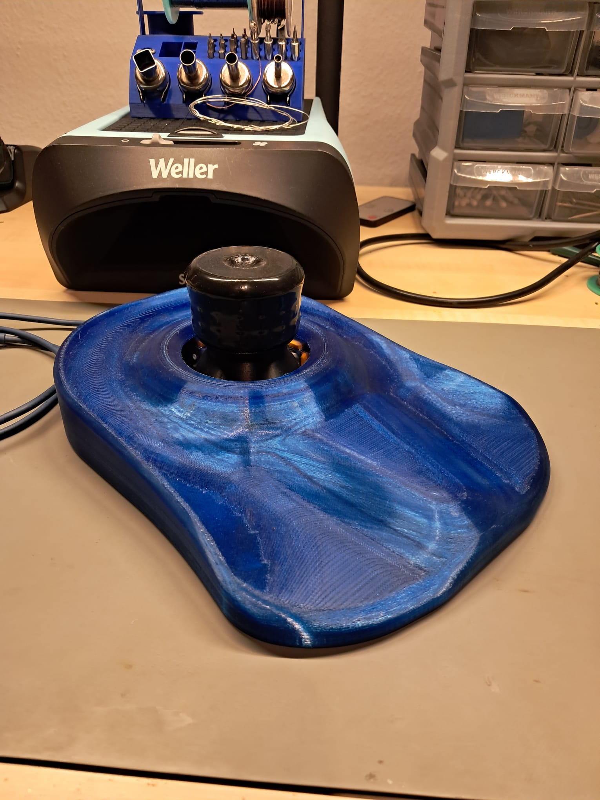
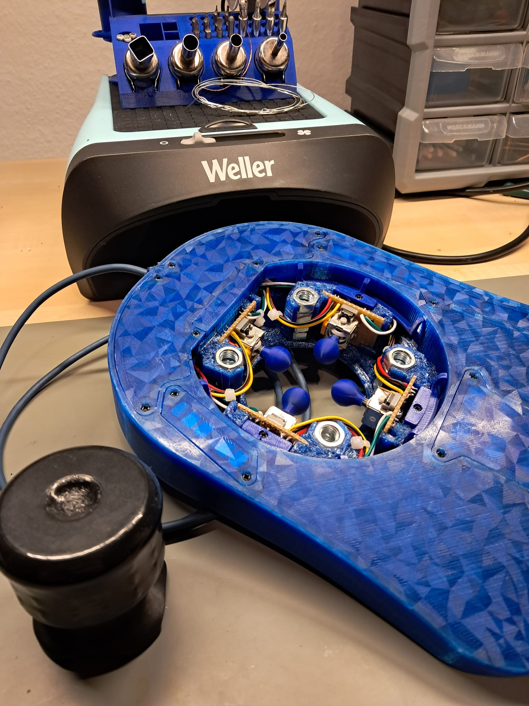
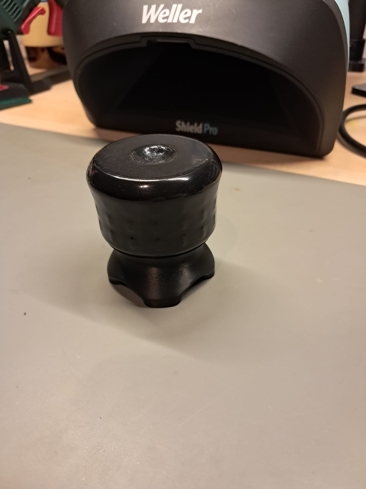
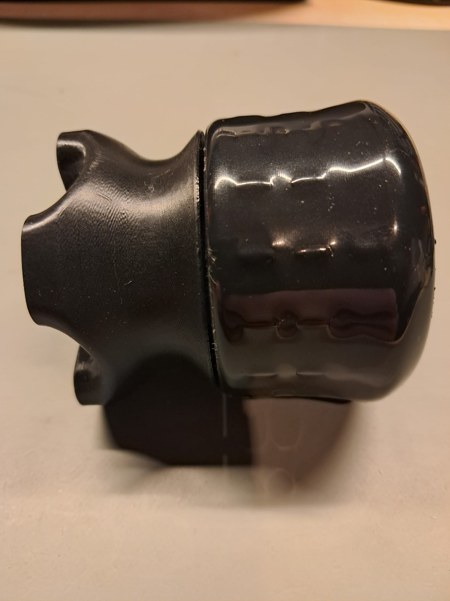

# 3D Printing & Surface Finishing

## Overview

For my personal ErgonoMouse MK XX build, I wanted to achieve a visually appealing design without compromising mechanical accuracy or functionality.

Since I already had transparent PETG available, I decided to use it for the main housing components. For the joystick control knob, however, I chose ASA to allow additional surface finishing through acetone vapor smoothing.

The main objectives were to achieve:

- A clean and partially transparent housing.
- High dimensional accuracy and good fitting tolerances.
- A smooth and comfortable control knob surface.
- A visually consistent finish using materials already available.

## 1. Transparent PETG – Material Preparation & Calibration

One of my initial goals was to achieve a high practical transparency using standard FDM printing.

Due to the complex geometry of the ErgonoMouse housing, achieving optical clarity comparable to transparent injection-molded parts was unrealistic. Nevertheless, I wanted to minimize visible defects and improve light transmission.

### Filament Preparation

Before printing, I thoroughly dried the PETG filament to minimize moisture-related printing defects.

Moisture absorbed by the filament can vaporize during extrusion, causing bubbles, inconsistent extrusion, and reduced optical quality.

### Print Calibration

To achieve consistent extrusion and dimensional accuracy, I performed several calibration tests:

- **Temperature Tower:** To identify a suitable printing temperature.
- **Flow Calibration:** To optimize extrusion flow and reduce inconsistencies.
- **Print Speed Test:** To evaluate suitable printing speeds.
- **Bridging Test:** To evaluate unsupported extrusion performance.
- **3DBenchy:** As an additional overall print-quality check.

I used a **0.4 mm nozzle with a layer height of 0.08 mm** to prioritize surface detail and resolution.

A straight infill pattern was selected to reduce intersecting internal extrusion paths, which can introduce additional interfaces and affect light transmission.

These adjustments improved the overall print quality, although the complex geometry and multiple internal material boundaries continued to limit transparency.

### Build Plate Selection

For the bottom-facing surfaces, I deliberately avoided a textured PEI build plate.

Instead, I used a smooth build plate with a geometric triangle pattern to obtain a more uniform and visually appealing finish.

However, PETG can bond very strongly to certain build surfaces, potentially damaging the coating during part removal.

To reduce this risk, I applied a compatible 3D-printing adhesive as a **release layer**, rather than primarily using it to increase adhesion.

## 2. ASA Control Knob – Printing & Surface Finishing

Besides the housing appearance, the surface quality of the control knob was particularly important to me.

As the knob is the primary physical interaction point of the SpaceMouse, its surface finish directly influences the tactile experience.

I selected **ASA (Acrylonitrile Styrene Acrylate)** because of its mechanical properties and compatibility with acetone-based surface finishing.

### Printing Preparation

Before printing, the ASA filament was dried and calibrated.

I also preheated the printer's build chamber by warming the build plate before starting the print.

Part cooling was disabled, while a low level of auxiliary airflow was maintained in my printer configuration.

The objective was to achieve consistent layer bonding, dimensional stability, and a suitable starting surface for post-processing.

### Acetone Vapor Smoothing

After printing, I experimentally treated the upper control knob with acetone vapor to reduce visible layer lines and improve its surface finish.

Acetone affects the outer surface of ASA, allowing it to soften and partially reflow. After the remaining solvent has evaporated, the treated surface can appear significantly smoother.

For my personal experiment, I used a transparent chemical-resistant container, a raised glass support, and acetone-containing absorbent material positioned around the printed component.

The treatment visibly reduced the layer lines and produced a more uniform surface. The component was subsequently left to dry for an extended period before handling and final assembly.

**Safety Notice:** Acetone vapor is highly flammable and presents inhalation and exposure hazards. An unsealed container does not provide controlled or safe ventilation, and an enclosed setup can accumulate hazardous vapor concentrations. This section documents a personal experiment, not a validated or recommended procedure. Solvent finishing requires appropriate chemical-handling precautions, controlled ventilation, and equipment designed for the associated risks.

### Surface Quality & Limitations

The visual improvement was substantial, especially along the curved outer surfaces of the knob.

However, vapor smoothing cannot fully correct geometric defects originating from the printing process.

A small recessed area on the upper surface remained imperfect because the knob had originally been printed with that region facing the build plate and without support structures.

Although the acetone treatment improved the surrounding surface, it could not completely eliminate this original printing defect.

This was an important practical observation: **surface finishing can reduce visible layer lines, but it cannot replace correct print orientation and mechanical design.**

## 3. Treated vs. Untreated Components

I deliberately left the lower mounting base of the control knob untreated.

This decision had two advantages:

1. **Visual Comparison:** The untreated base retains its original FDM layer lines, making the improvement of the smoothed upper knob clearly visible.
2. **Dimensional Accuracy:** Solvent treatment can alter surface geometry and fitting tolerances. Leaving the mounting base untreated helped preserve its original mechanical fit.

The lower component was only lightly sanded where necessary.

The following close-up provides a more detailed comparison between the untreated mounting base and the acetone-smoothed upper knob.

The treated upper section shows significantly reduced layer-line visibility, while the untreated base provides a reference for the original printed surface.

## 4. Final Result

The combination of transparent PETG housing components and an acetone-smoothed ASA control knob achieved the visual and tactile appearance I was aiming for.

Although the transparency of the PETG components was limited by the FDM printing process and the complex model geometry, the overall result was satisfactory for a personal build.

The ASA surface treatment was particularly effective at reducing visible layer lines and improving the perceived smoothness of the control knob.

The finished printed parts were combined with the electronics documented in the [Hardware Build](HARDWARE_BUILD.md).

---

**Attribution:** The original ErgonoMouse MK XX mechanical design was created by Jose L. González and remains subject to its original licensing terms. This document describes the printing and finishing of my personal build. No original 3D model files, modified STL files, or third-party print profiles are redistributed here.
